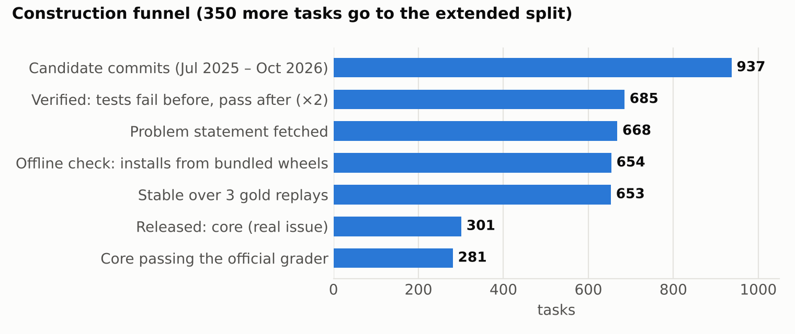
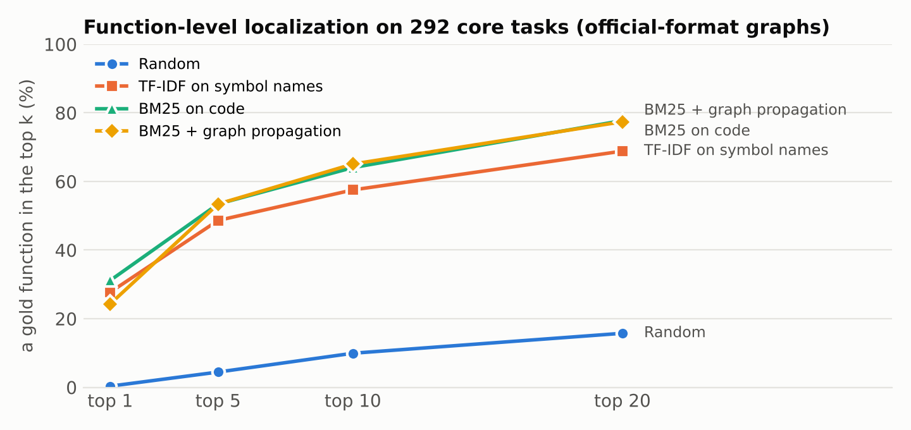
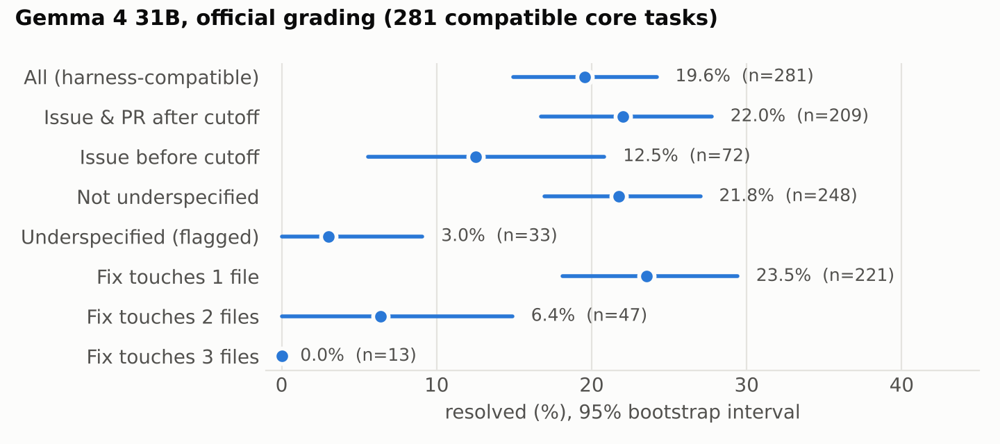

# Berth: Harness-Compatible, Post-Cutoff Python Tasks for Offline Gemma 4 Coding Agents

**Jay Patel**

## Abstract

Gemma 4 Developer Agent Competition entries run in one shared, offline Python 3.13 sandbox with code-graph tools, yet only 129 public tasks from four repositories exist in that format. Large public task sets ship a Docker image per task or repository and do not run in the harness. We release **Berth**: 651 verified bug-fix and feature tasks from 24 permissively licensed Python repositories, packaged in the competition's own layout. That covers `tasks.jsonl` columns, history-free snapshots and official-format code graphs, plus a wheel pool so every task installs with no network. Every task passed a twice-run fail-before/pass-after check, an offline install-and-test check and three gold replays. We then re-graded every task with the harness's own Phase 2 code, which is stricter than the usual rule, and record the result: **281 of the 301 core tasks** pass. Core uses real issue text, avoids every SWE-rebench release, and flags tasks postdating Gemma 4's January 2025 pretraining cutoff (209 of the 281). Each task carries function-level localization labels in official graph-node ids and an underspecification flag. Under official grading, a reference Gemma 4 31B agent resolves 19.6% of the 281 tasks (22.0% post-cutoff). In 59% of its failures it never edited a file the real fix touched.

## 1. Introduction

The competition asks for an open model that fixes real issues on modest hardware. Kaggle scores an entry on about 120 hidden tasks from private repositories, run one at a time in an offline sandbox [1]. Participants iterate against the 129 public development tasks: fastapi 67, rich 48, requests 13, httpx 1 [1]. That set is small, dominated by two repositories, and the only data in the exact format the harness consumes. A team tuning prompts, sub-agents or LoRA adapters therefore validates on the same few repositories it develops on. A team training with reinforcement learning has no pool of tasks the harness can run.

Outside task sets exist in large numbers [2–5], but they assume a per-task container with dependencies preinstalled. The competition harness instead unpacks a snapshot into one shared image and installs dependencies from a local wheel folder. It also turns on its graph tools only when a graph file and an embedding file exist for the task's commit. A task without them changes both the prompt the agent sees and the tools it can call.

**Contributions.**
1. **Berth**, 651 tasks (301 core, 350 extended) in the competition's data layout, each installable and testable offline.
2. A **verification pipeline** that removes four failure modes common in mined tasks: fixes that do not reproduce, environments that need the network, flaky tests, and tasks the official grader cannot pass. The last check reproduces the harness's Phase 2 grading with its own code, and it led us to two repairs: dependency resolution pinned to the fix commit's date, and test lists pruned for the validator's name matching.
3. **Function-level localization labels** in official graph-node ids, an **underspecification flag**, and a **pretraining-cutoff flag**, each validated against model behaviour.
4. **Baselines**: four localization rankers, and a reference Gemma 4 31B agent run on the competition's 4×L4 hardware, with every trajectory released.

## 2. What a Berth task contains

| Field / file | Content |
|---|---|
| `instance_id, repo, base_commit, patch, test_patch, problem_statement, hints_text, created_at` | Same columns as the official `tasks.jsonl` |
| `FAIL_TO_PASS`, `PASS_TO_PASS` | Pytest node ids, offline-stable (flaky must-pass tests moved to `PASS_TO_PASS_flaky`) |
| `snapshots/<id>` | Repository at `base_commit` as a fresh one-commit git repository, so `git log` cannot leak the fix |
| `graphs/<repo>_<commit>.json` | Code graph in the official node-link format |
| `embeddings/<repo>_<commit>.npz` | 256-d stand-in vectors per node (see §7) |
| `wheels/`, `requirements` | Exact pinned closure of every dependency, plus build backends |
| `localization` | `nodes_edited`, `nodes_added`, changed files, module-level changes |
| `quality`, `post_cutoff`, `split` | Underspecification flag, size measures, cutoff flag, split |
| `harness_compatible` | Gold resolves and the empty patch fails under the official Phase 2 rules (§3) |
| `*_dropped_validator`, `env_pinned_to_commit_date` | Test ids pruned for the official validator; whether dependencies were resolved as of the commit date |

Graphs are built with an Apache-2.0 builder published by another participant, which reproduces all 127 official graphs node-for-node and edge-for-edge [6]. It also reproduces the official graphs' quirks: no `async def` nodes, a single `calls` edge type, and no `self.method()` edges. As a result the three graph tools behave on Berth as they do on Kaggle.

## 3. Construction

**Sources.** We cloned 28 widely used, permissively licensed Python libraries outside the competition's four. Tasks in the release come from 24 of them, under MIT, BSD, or Apache-2.0 licenses (structlog is dual MIT/Apache). Each snapshot keeps its repository's license file.

**Mining.** On each default branch we kept first-parent commits since July 2025 that name a pull request, change 1–3 non-test source files, and change at least one test file: 937 candidates. Each commit's diff splits into `test_patch` (test files) and `patch` (everything else).

**Verification (online).** For each candidate, a fresh Python 3.13 environment installs the repository's declared test dependencies. We run the touched test files on base + `test_patch`, then twice on base + `test_patch` + `patch`. `FAIL_TO_PASS` holds tests that fail before the fix and pass in both later runs. A candidate is dropped if any previously passing test breaks or any result flips between the two runs. Of 934 unique pull requests, 685 verified; 172 had no failing-then-passing test, 52 had no runnable tests, and 25 errored or flipped.

**Problem statements.** Following SWE-bench [7], the statement is the text of the issue the pull request resolves. That issue comes from GitHub's closing link or a *fixes/closes/resolves #N* keyword ("issue", 243 core tasks), or else from a plain mention of an earlier issue ("issue_ref", 58). Pull requests without an issue keep their own description. That text often describes the fix, so those 350 tasks form the **extended** split, meant for training rather than evaluation. Seventeen pull-request numbers did not resolve and were dropped.

**Offline packaging.** Each task's frozen environment becomes a list of exact pins. The matching wheels go into a shared pool, built for CPython 3.13 where only a source release existed. Inside a Linux network namespace with no network, a fresh environment then installs only from that pool, applies `test_patch`, and confirms that the empty patch fails `FAIL_TO_PASS` and the gold patch passes it. 654 of 668 tasks passed.

**Stability.** Three more gold replays per task ran through the agent runner's own tool and grading path, offline, with two tasks in parallel. They used the portable CPython 3.13 and `uv` binary later shipped to Kaggle. Must-pass tests that failed in any replay were moved out of grading (6 tasks affected), and tasks whose `FAIL_TO_PASS` wavered were dropped (1). Across all stages, 1,943 of 1,962 replays resolved; every miss is accounted for by those removals.

**Decontamination.** We matched (repository, pull request) against every shard of SWE-rebench, SWE-rebench-V2 and SWE-rebench-V2-PRs [3]. Two candidates matched and are kept apart as an `overlap` split. Gemma 4's model card gives a January 2025 pretraining cutoff [8]. Every fix commit in core lands between 2025-07-06 and 2026-10-23, but 77 core tasks resolve an issue first filed before February 2025. We flag them rather than drop them (`post_cutoff = false`), and report results both ways.

**Official-grader check.** The competition grades a patch in a second, clean sandbox. It applies the agent's patch, resets and re-applies the test files, overwrites `pytest.ini` with its own settings, and runs `pytest -p no:anyio` on the whole target files. A patch resolves only if pytest exits with code 0 and a JUnit validator accepts every required test, matching each by name *prefix* [1]. We run exactly this sequence offline on every task. The harness's own `setup_workspace_test_config` and `_validate_junit_xml` are imported from the competition's `swegemma` wheel; the sandbox container itself is not used. A task is `harness_compatible` when the gold patch resolves and the empty patch does not. The first pass over core exposed three problems, each handled explicitly:
- **Async test suites** (13 core tasks, from uvicorn, starlette and structlog) cannot pass with the `anyio` plugin disabled. They stay in the release flagged incompatible; the organizers state that no hidden task touches async code [1].
- **Dependencies newer than the code** (33 tasks, mostly pydantic-settings). The latest releases break tests elsewhere in the same file, which our list-based check ignored. Re-verifying with dependencies resolved as of the fix commit's date (`uv --exclude-newer`) repaired 26 of them; every stage above was rerun for those tasks.
- **Prefix collisions.** A required test such as `test_case_sensitive` "matches" a skipped `test_case_sensitive_windows`. For 44 tasks we dropped colliding ids: 2,006 must-pass entries and 152 fail-to-pass entries, never the last fail-to-pass test. The dropped ids are recorded per task.

281 of 301 core tasks are harness-compatible. The other 20 are 13 async-test tasks and 7 with residual failures. All results below use official grading on these 281 unless stated.

**Localization labels.** Every changed line of the gold `patch` maps to the innermost `def`/`class` that contains it, using the official naming rule. Deleted or modified lines and insertion points map onto base-commit nodes (`nodes_edited`); added definitions map onto `nodes_added`; changes outside any node are recorded as module-level. Every labelled id was checked to exist in the corresponding graph.

**Underspecification flag.** A task is flagged when its hidden tests call a name the gold patch introduces and the issue text never mentions it. A correct fix with a different name would then fail. 36 core tasks are flagged (33 of the 281 compatible ones).

## 4. Dataset statistics

| | Core | Extended | Official dev set [1] |
|---|---|---|---|
| Tasks | 301 | 350 | 129 |
| Repositories | 23 | 24 (all splits) | 4 |
| Statement source | real issue | PR description | real issue |
| Pass the official grader | 281 | 297 | — |
| Post-cutoff (issue & PR after Jan 2025) | 224 (209 compatible) | 348 | — |
| Median added lines in gold patch | 19 | | |
| Files changed (1 / 2 / 3) | 236 / 52 / 13 | | |
| Median `FAIL_TO_PASS` / `PASS_TO_PASS` | 2 / 137 | | |
| Median gold functions edited | 2 | | |
| Tasks adding new definitions | 119 | | |
| Median graph size (nodes) | 1,173 (86–2,318) | | |

Core is spread more evenly than the official set. The largest repositories are pydantic-settings (55 tasks), packaging (45) and click (39); together they make up 46% of core, against 89% for fastapi and rich in the official set.

## 5. Baselines

### 5.1 Localization

For each of the 292 core tasks whose fix edits at least one function or class, we rank the base graph's nodes against the issue text. Test code is excluded by file path; the other nine core tasks change only module-level code. Rankers: random; TF-IDF over symbol names (the baseline a participant reported on the official tasks [9]); BM25 over symbol names plus source; and BM25 followed by personalized PageRank over graph edges, seeded with BM25's top 20. Intervals are 95% bootstraps.

| Ranker | gold fn @1 | @5 | @10 | @20 | gold file @1 | @5 |
|---|---|---|---|---|---|---|
| Random | 0.3% | 4.5% | 9.9% | 15.8% | 25.7% | 56.2% |
| TF-IDF (names) | 27.7% | 48.6% | 57.5% | 68.8% | 55.8% | 79.8% |
| BM25 (code) | 31.2% | 53.4% | 64.0% | 77.7% | 57.9% | 82.2% |
| BM25 + graph | 24.3% | 53.4% | 65.1% | 77.4% | 64.4% | 85.6% |

Graph propagation is a measurable trade-off rather than a free gain. It lowers top-1 function accuracy by 6.9 points [−12.7, −1.4] and raises top-1 file accuracy by 6.5 points [+0.7, +12.0]; at top 10 the two are indistinguishable (+1.0 [−2.4, +4.1]). Neighbours of a lexical match are often in the right file but are rarely the exact function to change. Our TF-IDF result (57.5% at top 10) is close to the 52% reported on the official tasks [9], which suggests Berth's localization difficulty is comparable.

### 5.2 Gemma 4 31B reference agent

We ran the competition checkpoint `gemma-4-31b-it-qat-w4a16-ct` on Kaggle's 4×L4 machine with the official vLLM build and server settings, with thinking on and no LoRA. The agent is deliberately simple. It has one level, the harness's five core tools (shell, read, edit, write, submit), temperature 0.7, a 40-turn cap and a 20-minute wall clock per task, with eight tasks in parallel. All 301 core tasks ran with no infrastructure errors. Each saved patch was then graded under the official rules of §3. On the 281 compatible tasks, our list-based grader and the official grader agree on 274; the official one is stricter on 6 and more lenient on 1.

**Overall.** 19.6% resolved [14.9, 24.2]; 22.0% [16.3, 27.8] on the 209 compatible post-cutoff tasks. Under our list-based grader on all 301 tasks the figure is 21.3%. Across all 301 attempts, the median used 25 turns and 12k output tokens, and 168 hit the 20-minute limit. The score belongs to this agent at this budget, not to the model: another participant reports about 49% for a tuned 31B agent on the official development set [6].

**Failures are mostly localization failures.** In 59.1% [52.6, 65.6] of unresolved attempts that produced a patch, the patch did not touch any file the gold fix changes. This matches §5.1: retrieval, not editing, is where a 31B agent loses most tasks. That is the gap the graph tools and the localization labels are meant to measure.

**The flags carry signal.** Flagged-underspecified tasks resolve at 3.0% against 21.8% for the rest. Pre-cutoff issues resolve *less* often (12.5%) than post-cutoff ones (22.0%), so we see no sign that memorized issue text inflates scores. Difficulty also rises sharply with breadth: 23.5% for one-file fixes, 6.4% for two, 0 of 13 for three. Berth is therefore far from saturated for the competition's model.

**Per repository.** Resolution ranges from 0/14 (platformdirs) to 10/18 (more-itertools). This spread is why a validation set needs many repositories.

### 5.3 Hidden-test calibration

The same agent, ported unchanged to the competition's declarative `agent.yaml` (budget 4.5 minutes per task, one task at a time, to fit the scorer's 12-hour limit), was submitted to the main competition's leaderboard, which scores it on hidden tasks from private repositories. Its score was still pending when this version was written, and will be added here when available. The comparison will calibrate Berth's difficulty against the hidden test, with one caveat: the leaderboard budget (4.5 minutes per task, one at a time) is much tighter than the 20 minutes used in §5.2.

## 6. Intended uses

- **Held-out validation for competition agents.** Core is post-cutoff, multi-repository and in the harness's format. Prompt and topology changes can be measured outside the four development repositories. We recommend the 209 tasks that are both `harness_compatible` and `post_cutoff` as the conservative headline subset.
- **Training pools.** The extended split, together with core tasks never used for evaluation, gives 651 offline-runnable environments for rejection-sampled SFT or RL. The 301 released Gemma trajectories start a pool of on-policy traces.
- **Graph-tool research.** Node-level labels let `search_similar_code`, `get_code_neighbors` and `get_code_subgraph` strategies be scored directly, without a full agent run.

## 7. Limitations

- **Stand-in embeddings.** The official embedding model is unpublished. Berth ships deterministic random vectors so the harness enables its graph tools. `search_similar_code` is therefore uninformative on Berth, and so is any result that depends on it. Another participant measured no significant difference between random and official vectors for a small Gemma model on the official tasks [6], but this is a real gap.
- **Official grading reproduced, not containerized.** We run the harness's Phase 2 sequence and its own setup and validation functions, but outside its container image, with environments installed from Berth's wheel pool. The competition image installs dependencies its own way and could differ on individual tasks. Twenty core tasks fail the official rules and are flagged rather than removed.
- **Pruned test lists.** Making 44 tasks pass the official validator removed 152 fail-to-pass ids. Those tasks test less than their original pull requests; the dropped ids are released so users can restore them under a different grader.
- **Scope.** All tasks are Python libraries with fast unit tests and small fixes (median 19 added lines). Long-horizon, multi-service or non-Python work is out of scope.
- **Reference agent.** Our Gemma numbers come from one sample per task under a single budget. They calibrate difficulty, not the model's ceiling.
- **Statement quality.** Issue text is used verbatim, so some issues are terse or discuss several problems. The underspecification flag is a lower bound, because it only detects tests that call names the issue never mentions.

## 8. Related work

SWE-bench introduced repository-level issue resolution judged by tests [7]. SWE-Gym [2], SWE-rebench [3], SWE-smith [4] and R2E-Gym [5] scale task collection for training, using per-task or per-repository containers. SWE-bench-Live keeps a continuously updated, post-cutoff stream [10]. LocAgent's Loc-Bench and MULocBench evaluate localization on their own, outside any agent loop [11, 12], and Agentless showed that explicit localization stages help [13]. Berth sits between these. It is smaller than the scaling efforts, but it targets one deployment harness exactly, adds node-level localization labels in that harness's graph ids, and validates its quality flags against model behaviour.

## 9. Release and reproducibility

Dataset (core, extended and overlap splits; snapshots, graphs, embeddings, wheels; all Gemma trajectories): https://www.kaggle.com/datasets/jayp2005/berth-swe-tasks, mirrored at https://huggingface.co/datasets/JayPatel2574/berth. Pipeline code (Apache-2.0), covering mining, verification, offline packaging, stability, localization, baselines, the Kaggle notebook generator and the numbers in this paper: https://github.com/JayPatel2574/berth. Each number in this paper is recomputed by `scripts/paper_numbers.py` from released files. Total compute was about 13 GPU-hours on Kaggle 4×L4 plus CPU-only verification.

## References

[1] Google DeepMind. *Google – The Gemma 4 Developer Agent Competition*: overview, data and harness README. Kaggle, 2026.
[2] J. Pan et al. *Training Software Engineering Agents and Verifiers with SWE-Gym.* arXiv:2412.21139, 2024.
[3] I. Badertdinov et al. *SWE-rebench: An Automated Pipeline for Task Collection and Decontaminated Evaluation of Software Engineering Agents.* arXiv:2505.20411, 2025.
[4] J. Yang et al. *SWE-smith: Scaling Data for Software Engineering Agents.* arXiv:2504.21798, 2025.
[5] N. Jain et al. *R2E-Gym: Procedural Environments and Hybrid Verifiers for Scaling Open-Weights SWE Agents.* arXiv:2504.07164, 2025.
[6] V. Nakrani. *gemma-4-developer-agent* (code-graph builder, measurements). github.com/nakranivaibhav/gemma-4-developer-agent, Apache-2.0, 2026.
[7] C. E. Jimenez et al. *SWE-bench: Can Language Models Resolve Real-World GitHub Issues?* ICLR 2024; arXiv:2310.06770.
[8] Google. *Gemma 4 model card* (pretraining data cutoff January 2025). 2026.
[9] Competition forum, topic #745731: audit of the official graphs and embeddings. Kaggle, 2026.
[10] L. Zhang et al. *SWE-bench Goes Live!* arXiv:2505.23419, 2025.
[11] Z. Chen et al. *LocAgent: Graph-Guided LLM Agents for Code Localization.* arXiv:2503.09089, 2025.
[12] Z. Zhang et al. *A Benchmark for Localizing Code and Non-Code Issues in Software Projects.* arXiv:2509.25242, 2025.
[13] C. S. Xia et al. *Agentless: Demystifying LLM-based Software Engineering Agents.* arXiv:2407.01489, 2024.
